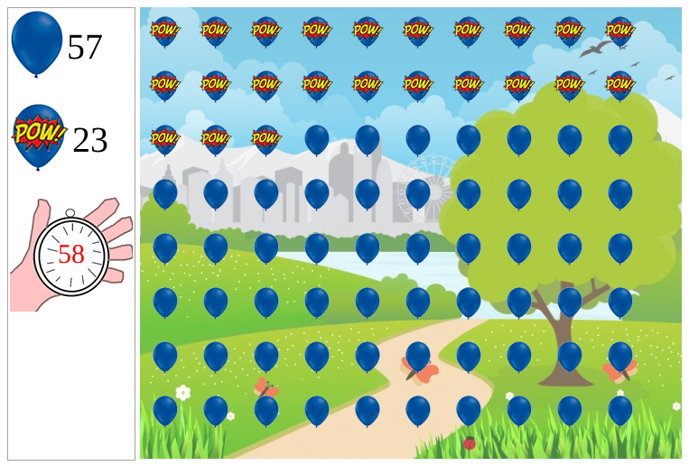

## Jogo de Explodir Balões

🎮 **Jogar online:** https://offryan.github.io/Game-Explode-Ballons/



### Desenvolvido em JavaScript puro, onde estão distribuídos 80 balões alinhados em um determinado espaço, na qual o objetivo é estourar todos antes do tempo acabar.

### Há 3 Modos de Dificuldade, ambos com 80 balões. Entretanto, quanto maior a dificuldade menor é seu tempo! Você consegue estourar todos no modo difícil?

Fácil:  120 segundos

Normal:   60 segundos

Difícil: 30 segundos

[hash_game.webm](https://user-images.githubusercontent.com/85769101/212357442-9f4ee568-6b9f-4172-8090-3b87240c9baf.webm)

### Como jogar

1. Escolha o nível e clique no botão de iniciar.
2. Clique nos balões para estourar: o placar mostra quantos faltam e quantos já foram.
3. Estoure todos antes do cronômetro zerar para vencer.

### Tecnologias

HTML, CSS e JavaScript (manipulação de DOM e `setTimeout` para o cronômetro), sem bibliotecas.

### Rodando localmente

```bash
git clone https://github.com/offryan/Game-Explode-Ballons.git
cd Game-Explode-Ballons
python -m http.server 8000
```

Acesse `http://localhost:8000`, ou simplesmente abra o `index.html` no navegador.
